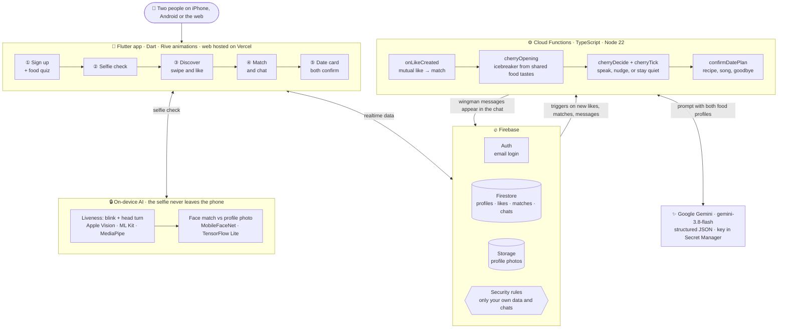

# 🍒 BakeOut

**Love might just be one recipe away.**

BakeOut is a food-first dating app. You match with people who cook and eat the way you do, and a cherry wingman (Jack or Jill) breaks the ice and helps you plan a real cooking date. Then it steps out, so the two of you can just talk.

It runs on **iPhone, Android and the web**, from one Flutter codebase.

👉 **Try it now:** [bakeout.vercel.app](https://bakeout.vercel.app)

---

## Why we built it

We're Vinamra (Scotland) and Subu (Alberta, Canada). We met at a Devpost hackathon a couple of years ago and have built together ever since. We both love cooking.

The idea started with a personal problem. Vinamra is an introvert and not a small-talk person, and dating apps are hard on both ends: getting a match, then starting a conversation once you have one. Despite all the progress in tech, the core of dating apps hasn't really changed. You swipe, say "hey", and never get to know each other.

We noticed something else: people with similar eating habits get along, even as friends. How you cook and eat says more about you than random small talk ever will. So we built the app we wished existed.

**The two problems BakeOut solves:**

1. **Small talk is hollow.** On most apps you swipe, say "hey", and never really get to know each other.
2. **Cooking alone gets old.** It isn't fun for everyone, and nobody keeps you on track with what you eat.

## What it does

- **Food-first profiles:** your cooking style, favourite dishes and food prompts come before anything else.
- **Discover and match:** swipe on people, and when the like is mutual you get a match moment.
- **Jack & Jill, your wingmen:** an AI wingman (powered by Gemini) joins the new chat. It writes a personal opener, nudges the chat if it goes quiet, and suggests a cooking date.
- **A real cooking date:** the wingman drafts a date card with the dish, day, time, recipe and a song. Both of you confirm it, and the wingman leaves the chat.
- **Friends mode:** looking for a cooking buddy instead of a date? Same app, same flow.
- **Genuine people:** a quick selfie check (blink, turn, look back) matched against your main photo. It runs entirely on your device; the selfie is never uploaded.
- **Recipes:** a library of recipes for when Discover runs out, or for your date.

## For judges: try it in one click

Open [bakeout.vercel.app](https://bakeout.vercel.app) on a computer. A **"Judging BakeOut?"** card sits to the right of the phone. On a narrow screen, tap **"Judging? Quick access"** on the welcome screen instead.

- **Log in as Maya** (Jill is her wingwoman) or **Arjun** (Jack is his wingman). They're already matched with each other, with the wingman's opening message waiting. Each also has a "liked you" from a sample profile. Open one in a normal window and the other in a private window to chat as both people.
- **Start fresh:** a throwaway account that goes through sign-up from the very first question. It can use Jack or Jill as a placeholder photo, and the selfie check can be skipped.

The six sample profiles in Discover always like you back, so any like becomes a match.

---

## How it works

### Architecture



The app talks to Firebase directly, behind security rules. The selfie check runs entirely on the device, and only the verified badge is saved. Everything the wingman (Jack or Jill) does runs on the server: each function reacts to something happening in Firestore, asks Gemini, and posts back into the chat.

### The wingman loop

```text
You like someone ──▶ Firestore "likes" ──▶ onLikeCreated (Cloud Function)
                                              │ mutual like?
                                              ▼
                                      "matches" document ──▶ cherryOpening: Gemini writes the opener
                                              │
                         chat messages ──▶ cherryDecide: should the wingman speak?
                          every minute ──▶ cherryTick: nudge a stalled chat, once
                                              │
                         both confirm the date card ──▶ confirmDatePlan: the wingman leaves
```

The wingman is called Cherry in the code: Jack for guys, Jill for girls. It follows a few rules we wrote ourselves: it's a mutual friend, not a chatbot. It never pretends a date is arranged, and it stays quiet once the two of you are talking.

### Tech stack

| Layer | What we used |
| --- | --- |
| App | Flutter and Dart (iOS, Android, web) |
| Sign-in and data | Firebase Auth, Cloud Firestore, Cloud Storage |
| Server | Cloud Functions v2, written in TypeScript (Node 22) |
| AI wingman | Google Gemini (`gemini-3.8-flash`) via `@google/genai` |
| Selfie check | Apple Vision (iOS), ML Kit (Android), MediaPipe (web), plus a MobileFaceNet model for the face match, all on-device |
| Animation | Rive. Jack and Jill are rigged from AI-generated parts. |
| Web hosting | Vercel |

### Project layout

```text
app/          Flutter app (lib/screens, lib/services, lib/widgets)
functions/    Cloud Functions: matching, Cherry the wingman, account deletion, demo seeding
design/       Mascot art and character rigs
devpost/      Our plan: scope, PRD, spec, checklist and app map
docs/         Mascot animation pipeline and playbook
firestore.rules, storage.rules   Security rules
```

---

## Set up and run

### 1. Install the tools

- [Flutter](https://docs.flutter.dev/get-started/install) (stable channel, Dart 3.13 or newer)
- [Node.js 22 or newer](https://nodejs.org/) (we use `nvm use 22`)
- Firebase CLI: `npm install -g firebase-tools`
- For iPhone: Xcode, signed in to your Apple ID under **Xcode › Settings › Accounts**
- For Android: Android Studio with an emulator or a phone

Your Google account must be a member of the Firebase project. Ask a teammate to add you under **Project settings › Users and permissions**.

### 2. Get the code

```sh
git clone https://github.com/nagusubra/build_with_ai_basics.git
cd build_with_ai_basics
```

### 3. Connect to Firebase (once per computer)

```sh
firebase login
sh app/scripts/setup.sh
```

This downloads the Firebase settings for iOS, Android and the web, and sets up your own Apple signing on a Mac. Everything it writes is git-ignored. Run it again with `--refresh` to start over.

### 4. Install packages

```sh
cd app && flutter pub get
cd ../functions && npm install
```

### 5. Run the app

From `app/`:

```sh
flutter run                     # pick a device from the list
flutter run -d chrome           # web
flutter run --release           # on your iPhone
```

The first time you install on an iPhone, trust your developer certificate under **Settings › General › VPN & Device Management**.

### 6. (Optional) Refresh the judge demo accounts

From `functions/` (requires [gcloud](https://cloud.google.com/sdk/docs/install), signed in):

```sh
nvm use 22
npm run seed:judges
```

This creates Maya, Arjun and the six sample profiles, and resets them to a clean slate. Run it again after judges have been through.

---

## Deploy

**Backend:** set the Gemini key once, then deploy the functions and rules:

```sh
firebase functions:secrets:set GEMINI_API_KEY
firebase deploy --only functions,firestore:rules,firestore:indexes,storage
```

**Web, on Vercel:**

```sh
cd app && flutter build web --release
cd build/web && npx vercel@latest --prod
```

`app/web/vercel.json` is copied into the build. It sends every route to the app and stops browsers caching stale code. Build with `--dart-define=JUDGE_ACCESS=false` to hide the judge shortcuts.

Profile photos load on the web because the Storage bucket allows browser reads. That setting lives in `storage.cors.json` and is applied once per project:

```sh
gcloud storage buckets update gs://studio-1391080484-497cf.firebasestorage.app --cors-file=storage.cors.json
```

## Tests

```sh
cd app && flutter test              # app unit tests, no device needed
cd functions && npm test            # server unit tests
cd functions && npm run check:matching   # matching, against the Firebase emulators
```

`functions/package.json` has more end-to-end checks (`check:cherry`, `check:date`, `check:chat` and others) that run against the local Firebase emulators.

---

## How we built it

This was our first time working plan-first: scope, then requirements, then a technical spec, then build. We did it with AI coding agents, following the [Build With AI: Basics](https://learn-ai-basics.devpost.com/) method. The plan documents live in [`devpost/`](devpost/). Start with [`scope.md`](devpost/scope.md), then [`prd.md`](devpost/prd.md) and [`spec.md`](devpost/spec.md).

Jack and Jill's animations are built in code from AI-generated parts. See the [animation workshop](app/tool/README.md) and the [pipeline notes](docs/mascot-animation-pipeline.md). More app details, including how the selfie check works on each platform, are in [`app/README.md`](app/README.md).

## Links

- Hackathon: [learn-ai-basics.devpost.com](https://learn-ai-basics.devpost.com/)
- Rules: [learn-ai-basics.devpost.com/rules](https://learn-ai-basics.devpost.com/rules)
- Skill pack: [github.com/challengepost/learn-ai-basics](https://github.com/challengepost/learn-ai-basics)

## License

[MIT](LICENSE)
